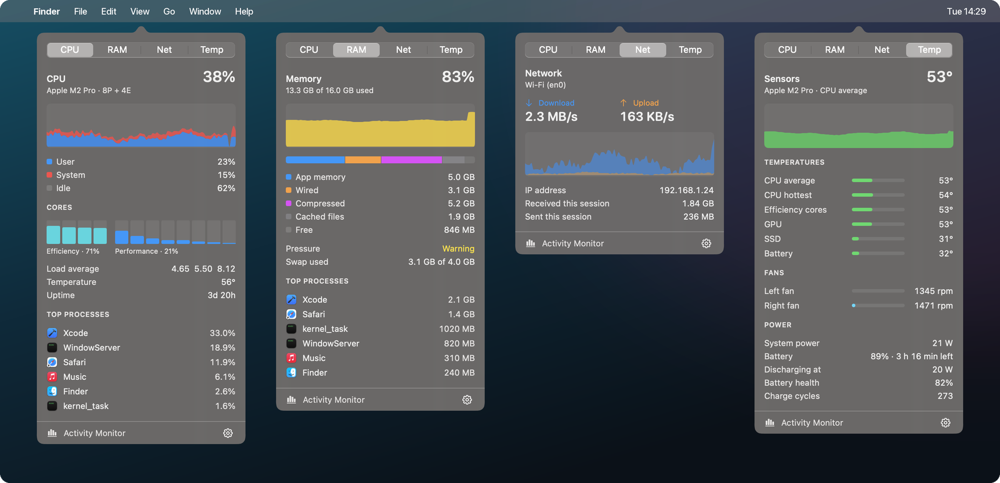

<div align="center">

# Gauge

**A lightweight system monitor for the macOS menu bar.**
CPU, GPU, memory, disk, network and sensors. Each one is its own menu bar item with a detailed popover.

[](https://github.com/Felix-Bergmann-Code/gauge/actions/workflows/build.yml)
[](LICENSE)


[](CONTRIBUTING.md)

[Website](https://felix-bergmann-code.github.io/gauge/) · [Contributing](CONTRIBUTING.md) · [Sister app: Isle](https://github.com/Felix-Bergmann-Code/isle)

<br>



</div>

---

Similar to iStat Menus, but free, open source and tiny: about **1.3% of one core** with the default modules. No dependencies, no network, no special permissions.

## Install

Build from source (takes about a minute):

```bash
git clone https://github.com/Felix-Bergmann-Code/gauge.git
cd gauge
./scripts/build.sh --install --run   # builds, copies to /Applications and launches
```

Requires **macOS 15+** and **Xcode 16+** (or a Swift 6 toolchain). Installing to `/Applications` is needed for *Launch at Login*. Drop `--install` to run from `./build` instead.

## Modules

| Module | Menu bar | Popover |
| --- | --- | --- |
| **CPU** | History graph (user/system), per-core bars, or percent | Usage history, per-core bars split into efficiency/performance, load average, temperature, uptime, top processes |
| **GPU** | History graph | Utilization history, peak, temperature, core count |
| **Memory** | Level bar colored by memory pressure | App/wired/compressed/cached breakdown, pressure, swap, top processes by memory |
| **Disk** | Read/write rates | Throughput history, volumes with free space (click to open), totals since boot |
| **Network** | Upload/download rates | Rate history, interface, IP address, session totals |
| **Sensors** | CPU temperature (+ fan speed when spinning) | CPU/GPU/SSD/battery temperatures, fans, system power, battery charge, health and cycles |

CPU, Memory, Network and Sensors are on by default. The gear in any popover toggles modules and sets the update interval (1–5 s), CPU style, colors, °F and Launch at Login. ⌘-drag items to reorder them; positions are remembered.

## Where the numbers come from

- **CPU**: `host_processor_info` tick deltas; core types from the device tree (`cluster-type`).
- **GPU**: `IOAccelerator` → `PerformanceStatistics` → `Device Utilization %`.
- **Memory**: `host_statistics64`, computed the way Activity Monitor does; pressure from `kern.memorystatus_vm_pressure_level`.
- **Disk**: `IOBlockStorageDriver` byte counters; volumes from `FileManager`.
- **Network**: `NET_RT_IFLIST2` counters of the primary interface. macOS gives unprivileged apps these counters rounded to 1 KiB and wrapped at 4 GiB, so very low rates are coarse and there are no since-boot totals.
- **Temperatures and fans**: SMC (per-chip key tables for M1–M4), with the IOHID PMU sensors as a fallback and for SSD/battery. Keys of a power-gated cluster read as junk below room temperature and are ignored.
- **Battery**: `AppleSmartBattery`; health matches System Settings (nominal / design capacity).
- **Top processes**: `/bin/ps` (setuid, so it also sees root processes such as WindowServer), only while a CPU or Memory popover is open. Memory uses the physical footprint where readable.

## Command line

```bash
BIN="$(swift build -c release --show-bin-path)/Gauge"
"$BIN" --dump          # print every reading once (great for testing a new Mac model)
"$BIN" --open cpu      # open a module's popover on launch
"$BIN" --demo          # sample processes, IP and drive names, pre-filled graphs (for screenshots)
```

## Performance

About 1.3% of one core with the default four modules at a 2 s interval (1.6% with all six). Sampling takes about 0.5 ms per tick; the rest is AppKit redrawing the items, which is skipped when an item hasn't changed. Popovers are created only while open.

## Contributing

PRs are very welcome! The most useful thing right now:

> 🌡️ **Sensor support for your Mac.** The SMC key tables have only been verified on an **M2 Pro**. If you have an M1, M3, M4 (or a Pro/Max/Ultra), run `Gauge --dump` and open an issue or PR with the output and any corrections to the key table.

Other ideas: Intel Mac support, more menu bar styles, an app icon. Read [CONTRIBUTING.md](CONTRIBUTING.md) to get set up, and please follow the [Code of Conduct](CODE_OF_CONDUCT.md).

## Project layout

```
Sources/Gauge/
  App/        app entry, settings, the sampling monitor, formatting
  Samplers/   CPU, GPU/sensors (SMC), memory, disk, network, battery, processes
  Views/      menu bar items and popover panels
scripts/      build.sh
```

## License

[MIT](LICENSE) © Felix Bergmann and contributors
